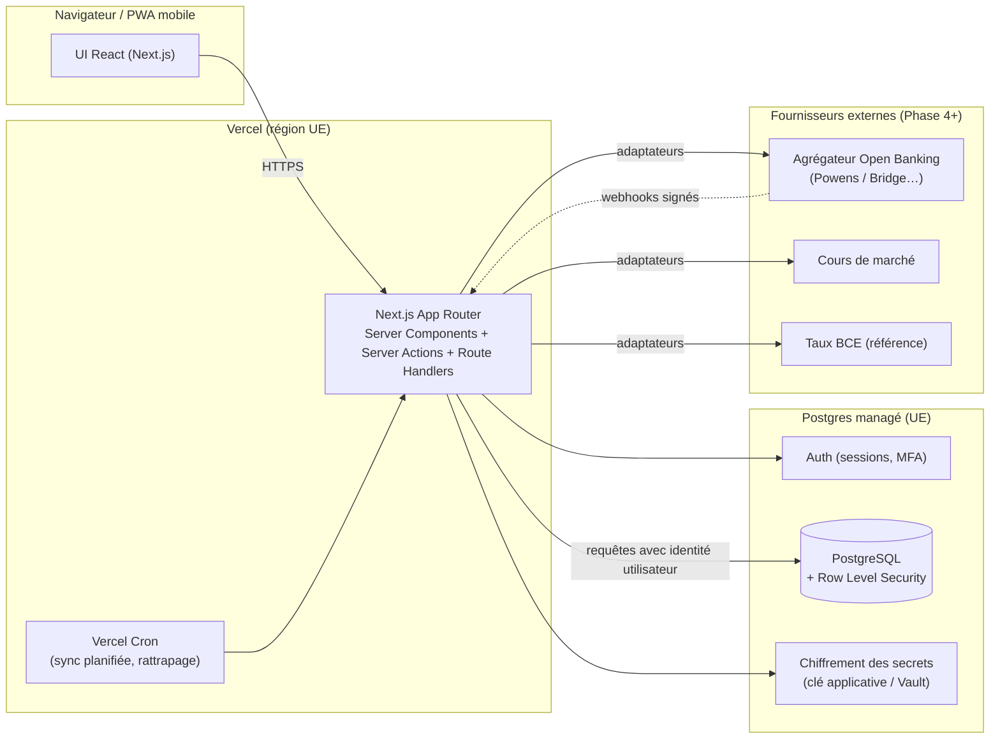

# FinNeo — Phase 0 : Conception

> Statut : **PROPOSITION — en attente de validation du propriétaire**. Aucun code applicatif n'a été écrit.
> Date : 21/11/2026. Les wireframes sont dans [`wireframes.md`](./wireframes.md).
> Règle : aucune donnée réelle (soldes, numéros de contrat, échéanciers bancaires) n'est versionnée dans ce dépôt. Les exemples ci-dessous sont fictifs.

Sommaire : 1 Brief · 2 Périmètre MVP · 3 Architecture · 4 Stack · 5 Modèle de données · 6 Sécurité · 7 Intégrations · 8 Maquettes (→ `wireframes.md`) · 9 Plan · 10 Déploiement · 11 Décisions à valider

---

## 1. Brief reformulé

**Objectif** : une application web/mobile personnelle qui consolide comptes, livrets, assurance-vie, placements, immobilier et crédits, et calcule un patrimoine net fiable, daté et traçable (type Finary, mais maîtrisé de bout en bout).

**Utilisateurs** : au démarrage un seul (le propriétaire), mais le modèle est multi-utilisateur et multi-espaces dès le jour 1 (isolation stricte, partage explicite uniquement).

**Cas d'usage prioritaires**
1. Voir en un écran le patrimoine net, sa répartition (liquidités / placements / immobilier / dettes) et son évolution.
2. Suivre les crédits : capital restant dû (CRD), prochaine échéance, coût total, date de fin, assurance séparée des intérêts.
3. Suivre chaque compte/livret/placement avec la **date et l'origine** de chaque valeur (synchronisée, saisie, estimée, contractuelle).
4. Mettre à jour rapidement les valeurs à la main (mobile) quand aucune synchro n'existe.
5. Plus tard : transactions, budget, connexions bancaires.

**Hypothèses (explicites, à corriger si fausses)**
- H1 : Le premier usage est *manual-first* : le patrimoine est saisi/importé, les connexions automatiques viennent après (cf. §7, la synchro Trade Republic est notoirement instable).
- H2 : Devise de référence EUR ; certains instruments sont cotés en USD (conversion via taux de change datés).
- H3 : Les échéanciers de prêt sont des **données contractuelles** : on les importe (CSV) plutôt que de les recalculer ; un calcul théorique n'est qu'un repli, étiqueté « estimé ».
- H4 : Un compte joint peut être détenu à une quote-part < 100 % (champ `ownership_share`, 100 % par défaut).
- H5 : Hébergement UE, données financières traitées comme sensibles (RGPD).
- H6 : Usage personnel non commercial : les offres gratuites des hébergeurs suffisent pour démarrer ; elles sont à re-vérifier avant production (limites et conditions évoluent).

**Limites** : pas de conseil en investissement ; pas de « temps réel » promis ; pas de collecte de mots de passe bancaires ; les projections sont toujours étiquetées et leurs hypothèses affichées.

**Questions ouvertes bloquantes** : voir §11 (peu nombreuses, le reste est couvert par des hypothèses).

---

## 2. Périmètre MVP

### Inclus (MVP = Phases 1 + 2 de la roadmap)
| # | Fonctionnalité | Critère d'acceptation (testable) |
|---|---|---|
| M1 | Inscription/connexion, vérification e-mail, récupération, **MFA TOTP** | Un compte sans MFA peut l'activer ; la connexion exige le 2ᵉ facteur ensuite ; sessions révocables depuis les paramètres |
| M2 | Multi-utilisateur + espaces patrimoniaux | Test d'intégration : l'utilisateur B reçoit 404/403 sur toute ressource de A (comptes, valorisations, prêts, exports) |
| M3 | Établissements et comptes (courant, joint, livret réglementé, assurance-vie, compte-titres, immobilier, autre) | CRUD complet ; chaque compte a une devise, un mode de valorisation et une quote-part |
| M4 | Valorisations datées et sourcées (append-only) | Chaque montant affiché montre date + étiquette (synchronisé / manuel / estimé / contractuel) ; l'historique est conservé |
| M5 | Positions d'investissement saisies (instrument, quantité, prix, devise) | Valorisation EUR = quantité × prix × taux du jour du prix ; arrondis testés |
| M6 | Crédits : paramètres + **import d'échéancier CSV** (capital, intérêts, assurance, échéance) | CRD à une date = capital dû de la ligne correspondante ; totaux de l'import = totaux du fichier ; écarts signalés |
| M7 | Tableau de bord : patrimoine net, répartition, courbe d'évolution, échéances à venir | Net = Σ actifs − Σ passifs selon la convention du §5 ; aucun double comptage (tests avec jeux de données vérifiables) |
| M8 | Indicateur de fraîcheur (« à jour », « ancien », « obsolète ») par valeur | Seuil configurable par type de compte ; états visibles sur dashboard et détail |
| M9 | Thème clair/sombre, responsive mobile-first, PWA installable (manifest + icônes, pas de hors-ligne des données financières) | Lighthouse a11y ≥ 90 ; navigation clavier complète ; `prefers-reduced-motion` respecté |
| M10 | Export (JSON/CSV) et suppression du compte et de ses données | L'export contient toutes les données de l'utilisateur ; la suppression est vérifiée en base |

### Différé (après MVP)
Transactions et catégorisation (Phase 3), cours de marché automatiques et taux de change automatiques (Lot 6), connexions agrégateur (Phase 4), notifications (Phase 5), budget, multi-devises complet, partage conjoint.

### Exclus
Collecte d'identifiants bancaires ; scraping ; ordres de bourse/virements (écriture bancaire) ; conseil financier ; fiscalité automatisée.

---

## 3. Architecture



**Principes**
- Le navigateur ne parle **jamais** aux fournisseurs ni à la base de données avec des droits étendus : tout passe par le serveur.
- Autorisation en **deux couches** : vérification applicative (`requireWorkspaceAccess`) *et* Row Level Security Postgres (défense en profondeur contre les IDOR/oublis).
- Les calculs de patrimoine vivent dans un module pur (`packages/core` ou `src/domain`), sans dépendance UI/DB, testé à part.
- Les fournisseurs externes sont derrière des interfaces (`BankAggregator`, `MarketDataProvider`, `FxProvider`) : remplaçables, mockables en dev.
- Les tâches (synchronisation, snapshots quotidiens) sont **idempotentes** et journalisées (`sync_jobs`, `sync_events`).
- Snapshot quotidien du patrimoine net (table `net_worth_snapshots`) pour les courbes, afin de ne pas recalculer tout l'historique à chaque affichage.

**Flux type « mise à jour manuelle d'une valeur »** : formulaire → Server Action (validation Zod, autorisation) → insertion d'une `valuation` (append-only, source=`manual`) → recalcul du snapshot du jour → revalidation du dashboard.

---

## 4. Stack technique

### Comparaison

| Élément | Option A (recommandée) | Option B | Option C |
|---|---|---|---|
| **App** | Next.js (App Router) + TypeScript strict | SvelteKit + TypeScript | SPA Vite/React + API séparée (Fastify/NestJS) |
| **Base** | PostgreSQL managé avec RLS (Supabase, région UE) | PostgreSQL managé sans BaaS (Neon) | PostgreSQL auto-géré / Railway / Fly |
| **Auth** | Supabase Auth (MFA TOTP, sessions, e-mail) | Better Auth / Auth.js (self-hosted dans l'app) | Keycloak / Auth0-Clerk |
| **ORM** | Drizzle (SQL typé, migrations lisibles) | Prisma | Kysely / TypeORM |
| **Tâches** | Vercel Cron + endpoints idempotents (puis Inngest si besoin) | Idem | Worker dédié |
| **Graphiques** | Recharts ou visx ; 3D limité (three.js / R3F) sur 1-2 visuels | Layerchart | idem |

### Critères

| Critère | A | B | C |
|---|---|---|---|
| Maintenabilité | Très bonne (1 repo, 1 langage, large écosystème) | Bonne (écosystème plus petit) | Moyenne (2 déploiements à tenir) |
| Coût | Gratuit pour démarrer ; plan payant probable en prod (sauvegardes, pas de mise en pause) | Gratuit/peu cher | Cher en temps, coût variable |
| Sécurité multi-utilisateur | **RLS native + MFA intégrée** | Isolation uniquement applicative (RLS possible mais à bâtir) | Dépend de l'implémentation |
| Déploiement | Immédiat (Git → Vercel, previews par PR) | Immédiat | Plus lourd |
| Mobile / PWA | Bonne (manifest, SW minimal) | Bonne | Bonne |
| Verrouillage fournisseur | Modéré : Postgres standard, auth remplaçable (adaptateur) | Faible | Faible |

### Recommandation
**Option A** : Next.js + TypeScript strict + Supabase (Postgres UE + Auth + RLS) + Drizzle + Zod + Tailwind/shadcn (design tokens). Raison principale : l'isolation entre utilisateurs est la contrainte la plus critique du projet, et A l'applique au niveau base sans effort de fondation, avec MFA incluse. Les montants sont en `NUMERIC` côté base et manipulés avec `decimal.js` (ou équivalent) côté code — jamais de `number` pour l'argent.

Alternative défendable : **B** si tu préfères garder l'auth dans l'application (moins de dépendance, plus de travail sécurité à notre charge).

*Qualité* : TypeScript `strict`, ESLint, Prettier, Vitest (unitaires), Playwright (E2E), tests RLS dédiés, CI GitHub Actions (lint, typecheck, tests, build, audit dépendances).

---

## 5. Modèle de données

### 5.1 Conventions de calcul (documentées)
- **Patrimoine net** = Σ(valeur courante des actifs × quote-part) − Σ(capital restant dû des passifs × quote-part), à une date donnée, en EUR.
- Chaque compte déclare **un seul** `valuation_mode`, ce qui évite les doubles comptages :
  - `balance` : sa valeur est son solde (courant, livret).
  - `positions_sum` : sa valeur = liquidités du compte + Σ positions (compte-titres). On n'ajoute **jamais** en plus une valorisation globale du compte.
  - `manual_valuation` : valeur saisie (assurance-vie, immobilier, véhicule).
  - `schedule` : passif dont le CRD est lu dans l'échéancier (crédits).
- Un bien immobilier est un **actif** ; son prêt est un **passif** distinct (le net immobilier est affiché, mais calculé, pas stocké).
- Les virements entre comptes sont des `transfer` (jamais revenu/dépense) ; ils sont liés par `transfer_group_id`.
- Performance d'investissement = variation de valeur **hors** flux (versements/retraits stockés séparément) ; méthode documentée avant implémentation (TWR/MWR à décider au Lot 6).
- Chaque valeur : `amount`, `currency`, `as_of` (date de valeur), `recorded_at`, `source`, `method`, et le taux de change utilisé si conversion.
- Intérêts, assurance et frais de prêt sont des colonnes distinctes de l'échéancier (l'échéance « assurance comprise » est une somme, pas une donnée primaire).

### 5.2 ERD

```mermaid
erDiagram
  USERS ||--o{ WORKSPACE_MEMBERS : "appartient"
  WORKSPACES ||--o{ WORKSPACE_MEMBERS : "a"
  WORKSPACES ||--o{ ACCOUNTS : "contient"
  WORKSPACES ||--o{ INSTITUTIONS : "référence"
  INSTITUTIONS ||--o{ ACCOUNTS : "héberge"
  ACCOUNTS ||--o{ VALUATIONS : "est valorisé par"
  ACCOUNTS ||--o{ POSITIONS : "détient"
  INSTRUMENTS ||--o{ POSITIONS : "est détenu"
  INSTRUMENTS ||--o{ PRICES : "est coté"
  ACCOUNTS ||--o{ TRANSACTIONS : "enregistre"
  CATEGORIES ||--o{ TRANSACTIONS : "classe"
  ACCOUNTS ||--o| LOANS : "est un crédit"
  LOANS ||--o{ LOAN_SCHEDULE_LINES : "échéancier"
  LOANS }o--o| ACCOUNTS : "finance (bien/véhicule)"
  WORKSPACES ||--o{ NET_WORTH_SNAPSHOTS : "historise"
  WORKSPACES ||--o{ CONNECTIONS : "possède"
  CONNECTIONS ||--o{ CONSENTS : "autorisé par"
  CONNECTIONS ||--o{ SYNC_JOBS : "déclenche"
  SYNC_JOBS ||--o{ SYNC_EVENTS : "journalise"
  CONNECTIONS ||--o{ ACCOUNT_LINKS : "relie"
  ACCOUNT_LINKS }o--|| ACCOUNTS : "vers"

  WORKSPACES { uuid id PK; text name; char base_currency }
  WORKSPACE_MEMBERS { uuid workspace_id FK; uuid user_id FK; text role }
  ACCOUNTS { uuid id PK; uuid workspace_id FK; uuid institution_id FK; text kind; text valuation_mode; char currency; numeric ownership_share; text source_mode; bool archived }
  VALUATIONS { uuid id PK; uuid account_id FK; date as_of; numeric amount; char currency; numeric fx_rate; text source; text method; timestamptz recorded_at }
  INSTRUMENTS { uuid id PK; text isin; text name; text kind; char currency }
  POSITIONS { uuid id PK; uuid account_id FK; uuid instrument_id FK; numeric quantity; numeric cost_basis; date as_of; text source }
  PRICES { uuid instrument_id FK; date as_of; numeric price; char currency; text source }
  LOANS { uuid account_id PK_FK; text kind; numeric principal; numeric rate; date first_due; date last_due; numeric monthly_payment; text schedule_source }
  LOAN_SCHEDULE_LINES { uuid loan_id FK; date due_date; numeric principal_due_before; numeric principal; numeric interest; numeric insurance_fees; numeric total_payment }
  TRANSACTIONS { uuid id PK; uuid account_id FK; date booked_at; numeric amount; char currency; text kind; uuid category_id FK; uuid transfer_group_id; text external_id; text status }
  FX_RATES { char base; char quote; date as_of; numeric rate; text source }
  NET_WORTH_SNAPSHOTS { uuid workspace_id FK; date as_of; numeric assets; numeric liabilities; numeric net; jsonb breakdown }
  CONNECTIONS { uuid id PK; uuid workspace_id FK; text provider; text status; timestamptz last_synced_at; bytea secret_ciphertext }
  CONSENTS { uuid id PK; uuid connection_id FK; text scopes; timestamptz granted_at; timestamptz expires_at; timestamptz revoked_at }
  SYNC_JOBS { uuid id PK; uuid connection_id FK; text status; timestamptz started_at; timestamptz ended_at }
  SYNC_EVENTS { uuid id PK; uuid job_id FK; text level; text code; jsonb meta }
  ACCOUNT_LINKS { uuid connection_id FK; uuid account_id FK; text external_account_id }
  AUDIT_LOG { uuid id PK; uuid user_id; text action; text entity; timestamptz at }
```

### 5.3 Contraintes, index, règles d'accès
- **Clés** : UUID v7 ; `workspace_id` présent (ou déductible par jointure indexée) sur toute table patrimoniale.
- **Montants** : `NUMERIC(19,4)` ; quantités `NUMERIC(28,10)` ; taux `NUMERIC(18,10)` ; devises ISO 4217 (`CHAR(3)` + CHECK).
- **Contraintes** : `ownership_share` ∈ ]0,1] ; `valuations` append-only (pas d'UPDATE/DELETE hors suppression de compte, via trigger) ; unicité `(account_id, as_of, source)` quand pertinent ; unicité `(account_id, external_id)` pour dédupliquer les transactions synchronisées ; `loan_schedule_lines` unique `(loan_id, due_date)`.
- **Index** : `(account_id, as_of DESC)` sur valorisations/positions ; `(workspace_id, as_of)` sur snapshots ; `(account_id, booked_at DESC)` sur transactions ; `(instrument_id, as_of DESC)` sur prix.
- **RLS** : politique unique par table — l'accès exige une ligne `workspace_members` pour `auth.uid()` ; rôles `owner` / `editor` / `viewer` ; aucune politique « tout autorisé » ; tables de connexions/secrets accessibles **uniquement** via le rôle serveur.
- **Soft vs hard delete** : archivage des comptes (historique conservé) ; suppression définitive uniquement sur demande utilisateur (cascade vérifiée par test).

---

## 6. Sécurité et confidentialité

### Modèle de menace (principaux risques)
| Menace | Impact | Mesures |
|---|---|---|
| Accès aux données d'un autre utilisateur (IDOR, API bavarde) | Critique | RLS + contrôle applicatif sur chaque action ; tests d'isolation en CI ; identifiants non devinables (UUID) ; aucune confiance dans l'UI |
| Vol de compte (phishing, mot de passe faible) | Critique | MFA TOTP (passkeys à évaluer), politique de mot de passe, limitation de tentatives, alerte sur nouvelle session, révocation des sessions |
| Fuite de tokens d'agrégation | Critique | Jamais côté navigateur ; chiffrement applicatif AES-256-GCM (clé hors base, rotation) ; jamais dans les logs ni le dépôt ; révocation en un clic |
| Injection / XSS / CSRF | Élevé | Requêtes paramétrées (ORM), validation Zod côté serveur, échappement React, CSP stricte, cookies `HttpOnly; Secure; SameSite`, protection CSRF des mutations |
| SSRF via URLs fournisseur | Moyen | Aucune URL arbitraire fournie par l'utilisateur ; liste blanche de domaines |
| Abus / brute force / scraping de l'API | Moyen | Rate limiting par IP et par utilisateur sur auth, exports et sync |
| Fuite via logs, previews, exports | Élevé | Pas de montants/secrets dans les logs ; previews **sans** données de production ; exports authentifiés, ré-authentification récente exigée |
| Perte/corruption des données | Élevé | Sauvegardes managées + export chiffré périodique + **test de restauration** planifié |
| Compromission de dépendances | Moyen | `npm audit`/Dependabot, lockfile, revue avant release, permissions minimales des tokens CI |
| Compromission de l'hébergeur / insider | Moyen | Principe du moindre privilège, secrets par environnement, accès console protégés par MFA |

### Autres mesures
- **Headers** : CSP, HSTS, `X-Content-Type-Options`, `Referrer-Policy`, `Permissions-Policy`, frame-ancestors `none`.
- **Secrets** : variables d'environnement par environnement ; `.env.example` avec valeurs factices ; scan de secrets en CI (type gitleaks) ; aucune variable sensible préfixée `NEXT_PUBLIC_`.
- **Logs** : événements de sécurité (connexion, changement de MFA, export, révocation) sans données financières ; rétention limitée.
- **RGPD** : minimisation, hébergement UE, export et suppression en libre-service (M10), registre des traitements simple (usage personnel mais bonne pratique).
- **Incidents** : procédure documentée (`docs/incident-response.md` à créer au Lot 1) : révoquer sessions et tokens, faire tourner les clés, évaluer la fuite, notifier si requis.
- **Avant production** : revue des dépendances, permissions, configuration, test d'intrusion basique (checklist OWASP ASVS niveau 1-2). Toute faille critique bloque la release.

---

## 7. Intégrations

*Recherche externe effectuée le 21/11/2026 ; à re-vérifier avant tout engagement (offres, prix, périmètres évoluent).*

### 7.1 Agrégateurs Open Banking / PSD2 (DSP2)
| Option | Ce qui est établi | Points d'attention |
|---|---|---|
| **Powens** (ex-Budget Insight) | Agrégateur agréé DSP2 (ACPR) ; 1 800+ établissements dans 12+ pays et 200+ plateformes d'investissement annoncés ; bac à sable gratuit ; webview de consentement, webhooks de synchronisation ; utilisé par des acteurs du marché | Offre B2B : les conditions et le prix d'un accès production pour un projet personnel sont **inconnus** (non publiés) ; contact commercial probable |
| **Bridge** (Bankin') | API v3 avec sessions « Connect » et webhooks | Mêmes réserves B2B/prix ; à comparer au moment du choix |
| Tink, Yapily, GoCardless Bank Account Data | Alternatives européennes | Disponibilité et conditions pour particuliers/projets perso à vérifier (je n'ai pas pu le confirmer) |

### 7.2 Courtiers / plateformes d'investissement
- **Trade Republic** : d'après les fils d'incident de la communauté Finary (via Powens), il n'existe pas d'API officielle ouverte aux agrégateurs pour les données de comptes ; la synchro passe par des mécanismes fragiles (authentification par code, limitation de débit, pannes récurrentes). Une API Open Banking limitée au compte courant a été annoncée mais son ouverture effective aux agrégateurs n'était pas confirmée dans les sources consultées.
  → **Décision de conception** : Trade Republic en **saisie manuelle / import de fichier** au MVP ; adaptateur agrégateur ajouté seulement si la fiabilité est démontrée. Pas de scraping.
- **BoursoBank, CIC, Banque Populaire** : couverts en principe par les agrégateurs DSP2 pour les comptes de paiement et l'épargne ; assurance-vie et prêts souvent absents ou partiels → saisie manuelle / import d'échéancier.

### 7.3 Données de marché et change
- **Taux de change** : taux de référence **BCE** (publication quotidienne, gratuit) via un `FxProvider`.
- **Cours** : `MarketDataProvider` à choisir au Lot 6 (critères : couverture par ISIN, cours de clôture suffisants, licence d'usage personnel, coût). Aucune source non officielle/fragile par défaut. Repli permanent : prix saisi à la main.

### 7.4 Contrat de l'adaptateur (indépendant du fournisseur)
```ts
interface BankAggregator {
  startConnection(workspaceId, redirectUri): Promise<{ url: string }>;   // parcours de consentement du fournisseur
  completeConnection(callbackParams): Promise<ConnectionRef>;
  listAccounts(conn): Promise<ExternalAccount[]>;
  fetchBalances(conn): Promise<ExternalBalance[]>;
  fetchTransactions(conn, since, cursor?): Promise<Page<ExternalTransaction>>;
  verifyWebhook(headers, body): VerifiedEvent;      // signature obligatoire
  revoke(conn): Promise<void>;
}
```
**Exigences communes** : consentement explicite par compte, suivi `expires_at` + alerte de renouvellement, révocation, synchronisation **idempotente** (clé `external_id`), pagination, retries avec backoff exponentiel, timeouts, gestion des erreurs partielles, réconciliation (écarts de solde signalés, jamais corrigés silencieusement), limites de fréquence respectées.
**Fraîcheur** : elle dépend du fournisseur (souvent au mieux quotidienne, parfois bloquée par la banque). L'UI affiche toujours « dernière synchro réussie » + source ; le mot « temps réel » est proscrit. L'état « connecté » ne doit jamais masquer une dernière synchro ancienne.

---

## 8. Maquettes
Voir [`wireframes.md`](./wireframes.md) : navigation, écrans desktop et mobile (connexion/inscription, tableau de bord, comptes, détail de compte, investissements, immobilier, crédits, transactions, intégrations, paramètres), états `loading / empty / error / obsolete`, et direction visuelle.

---

## 9. Plan de réalisation

Estimations relatives : S (≤ 1 j), M (2-3 j), L (4-6 j), XL (> 1 sem.) en temps de travail effectif.

| Lot | Contenu | Dépend de | Taille | Critères d'acceptation principaux |
|---|---|---|---|---|
| **L0** | Dépôt, CI (lint, typecheck, tests, build, gitleaks), design tokens, thème clair/sombre, squelette de navigation | validation Phase 0 | M | CI verte ; déploiement preview ; `.env.example` ; README d'installation |
| **L1** | Auth + MFA, utilisateurs, espaces, RLS, tests d'isolation | L0 | L | M1, M2 validés ; test automatisé « B ne voit rien de A » |
| **L2** | Établissements, comptes, valorisations append-only, fraîcheur | L1 | L | M3, M4, M8 |
| **L3** | Positions d'investissement manuelles, FX manuel puis BCE | L2 | M | M5 ; jeux de test de conversion |
| **L4** | Crédits : paramètres, import d'échéancier CSV, CRD, coût total, assurance séparée | L2 | L | M6 ; totaux = fichier source (tests avec données fictives) |
| **L5** | Dashboard : net, répartition, snapshots, courbe, échéances | L2-L4 | L | M7 ; cas limites (devise, quote-part, compte archivé) |
| **L6** | Cours de marché automatiques, performance hors flux | L3 | M | Provider choisi ; dates de cotation affichées |
| **L7** | PWA, accessibilité, export/suppression, durcissement sécurité, revue pré-prod | L1-L5 | L | M9, M10 ; checklist §6 complète |
| **L8** | Transactions + catégories + budget | L2 | XL | Phase 3 |
| **L9** | Connexions agrégateur (1 fournisseur) | L2, L8 | XL | Phase 4 ; sync idempotente démontrée |

**Mise en production** possible après L7 (MVP). L8-L9 sont des incréments.

**Risques principaux** : (R1) accès production agrégateur incertain pour un projet perso → mitigé par le manual-first ; (R2) dérive visuelle (3D/verre) au détriment des perfs/accessibilité → budget de performance et repli ; (R3) échéanciers hétérogènes entre banques → format CSV pivot + validateur ; (R4) conventions de calcul contestées → documentées et testées dès L5 ; (R5) coût hébergement (pause projet gratuit, sauvegardes) → décision plan payant à l'approche de la prod.

**Stratégie de tests** : unitaires (domaine/calculs : arrondis, devises, quote-part, CRD, doublons), intégration (actions serveur + base), **tests RLS/autorisation** (2 utilisateurs, matrice de ressources), E2E Playwright (parcours : inscription+MFA, ajout compte, valorisation, import prêt, dashboard), accessibilité (axe), non-régression visuelle ciblée. Données de test **exclusivement fictives**.

---

## 10. Déploiement et exploitation

- **Hébergement** : Vercel (app, previews par PR, production sur `main`) ; base managée (Supabase) en région UE ; URL HTTPS stable, domaine personnalisé optionnel.
- **Environnements** : `local` (base locale via CLI/Docker, données fictives) · `preview` (projet base séparé, données de seed fictives, protégé par authentification Vercel) · `production`. **Aucune preview connectée à la production.**
- **Secrets** : gérés par environnement dans Vercel/base ; clé de chiffrement distincte par environnement ; rotation documentée.
- **Migrations** : versionnées dans le dépôt, appliquées en CI (preview) puis en production après validation ; pas de migration destructive sans accord (règle CLAUDE.md) ; stratégie « expand/contract ».
- **Monitoring** : health check `/api/health` (sans donnée sensible), erreurs applicatives (service de suivi d'erreurs avec scrubbing des montants), alertes sur échecs de synchro et de snapshot.
- **Sauvegardes / restauration** : sauvegardes managées (point-in-time si plan adapté) + export chiffré périodique hors plateforme ; **test de restauration** avant production puis chaque trimestre.
- **Rollback** : application = redéploiement de la version précédente (Vercel) ; base = migrations rétro-compatibles, sinon restauration ; procédure écrite avant L7.
- **Disponibilité** : objectif, non garantie (hébergeur, base, fournisseurs). Coûts de départ : proches de zéro ; à ré-évaluer avant prod (plan base payant probable, domaine, éventuel agrégateur).

---

## 11. Synthèse de validation — décisions à approuver avant de coder

| # | Décision | Recommandation | À toi de trancher |
|---|---|---|---|
| D1 | Stack | Next.js + TS strict + Supabase (Postgres UE, Auth, RLS) + Drizzle | OK / Option B / autre |
| D2 | Stratégie de données | **Manual-first** (saisie + import CSV), agrégateur en Phase 4 | OK / agrégateur dès le début |
| D3 | Trade Republic | Saisie/import, pas de synchro auto au MVP | OK |
| D4 | MFA | TOTP obligatoire à l'activation de la prod (passkeys en option) | OK |
| D5 | Périmètre MVP | M1-M10 (sans transactions ni budget) | Ajouter/retirer |
| D6 | Échéanciers de prêt | Import CSV pivot ; calcul théorique en repli étiqueté « estimé » | OK |
| D7 | Direction visuelle | Premium sobre ; clair/sombre ; verre dépoli (« liquid glass ») avec replis d'accessibilité ; **pas d'inclinaison 3D des cartes** ; 3D réservé à 1-2 visuels héros ; animations coupées avec `prefers-reduced-motion` | Valider l'intensité |
| D8 | PWA | Installable, pas de cache hors-ligne des données financières | OK |
| D9 | Coûts | Free tiers pour L0-L6 ; décision plan payant avant la prod | Plafond mensuel acceptable ? |
| D10 | Quote-part des comptes joints | Champ `ownership_share` (100 % par défaut) | Quelle règle pour le compte joint ? |
| D11 | Valorisation immobilière | Saisie manuelle datée, étiquetée « estimée » (pas d'API d'estimation) | OK |
| D12 | Données réelles | Saisies uniquement dans l'app déployée ; jamais dans Git, issues ou previews | OK |

**Questions réellement bloquantes** : D1 (stack), D2 (manual-first vs agrégateur), D7 (intensité visuelle), D10 (compte joint). Pour les autres, je pars des hypothèses ci-dessus.

**Informations utiles (non bloquantes)** : échéancier du prêt immobilier (au format tableau, pour valider la convention de CRD) ; liste des véhicules/biens à suivre comme actifs ; nom de marque/palette si tu en as une.

> Prochaine étape après ton accord explicite : **L0** (dépôt, CI, tokens de design, squelette) — avec objectif, fichiers concernés et critères d'acceptation rappelés avant de commencer.
