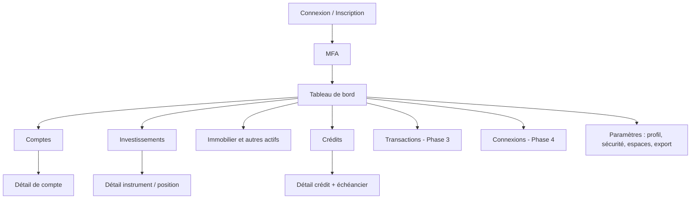

# FinNeo — Wireframes et direction visuelle (Phase 0)

> Statut : proposition à valider. Les montants ci-dessous sont **fictifs**.
> Légende : `[ ]` bouton/champ · `▸` navigation · `●` valeur à jour · `◐` ancienne · `○` obsolète · `✎` saisie manuelle · `⟳` synchronisé · `≈` estimé · `§` contractuel

## 1. Navigation



- **Mobile** : barre d'onglets basse (Accueil · Comptes · Placements · Crédits · Plus). « Plus » = Immobilier, Transactions, Connexions, Paramètres. Bouton d'action flottant « Mettre à jour une valeur ».
- **Desktop** : barre latérale repliable + en-tête (sélecteur d'espace, recherche, thème, profil). Contenu en grille 12 colonnes, largeur max ~1280 px.

## 2. Direction visuelle (à valider — D7)

- Premium mais sobre : chiffres lisibles en premier (police à chiffres tabulaires), couleurs sémantiques réservées au sens (hausse/baisse/alerte), jamais décoratives seules.
- **Thèmes clair et sombre** par tokens ; thème système par défaut.
- **Verre dépoli (« liquid glass »)** sur surfaces flottantes (en-tête, cartes de synthèse, feuilles modales) via `backdrop-filter`. Replis : fond opaque si `prefers-reduced-transparency`, si le navigateur ne supporte pas l'effet, ou si le contraste texte/fond < 4,5:1.
- **Aucune inclinaison 3D au survol des cartes.** 3D limité à 1-2 visuels « héros » (ex. donut de répartition), chargé en différé, désactivé en `prefers-reduced-motion` et sur appareils faibles.
- Animations courtes (150-300 ms) : comptage des montants à l'ouverture, transitions de graphiques, états de chargement par squelettes. Tout est coupé en `prefers-reduced-motion`.
- Budget de performance : LCP < 2,5 s sur mobile milieu de gamme, JS initial < 200 kB gzip hors graphiques.
- Accessibilité : WCAG 2.2 AA, focus visibles, graphiques accompagnés d'un tableau de données, aucune information portée par la couleur seule.

## 3. Écrans

### 3.1 Connexion / Inscription / MFA
```
┌───────────────────────────────┐
│           FinNeo              │
│  Connexion        Inscription │
│  [ E-mail                   ] │
│  [ Mot de passe          👁 ] │
│  [        Se connecter      ] │
│  Mot de passe oublié ?        │
│───────────────────────────────│
│  Code à 6 chiffres (MFA)      │
│  [ _ _ _ _ _ _ ]  [Valider]   │
│  Utiliser un code de secours  │
└───────────────────────────────┘
```
États : erreur générique (« Identifiants invalides », sans révéler l'existence du compte) · trop de tentatives (délai affiché) · e-mail non vérifié · session expirée.

### 3.2 Tableau de bord
Desktop :
```
┌──────────┬───────────────────────────────────────────────────────────────┐
│ ▸Accueil │ Espace : Personnel ▾                 🔍   ☀/🌙   Profil        │
│ ▸Comptes ├───────────────────────────────────────────────────────────────┤
│ ▸Placem. │ PATRIMOINE NET            Actifs        Dettes                 │
│ ▸Immo    │ 123 456,78 €  ▲ +1,2 %    180 000 €     56 543 €               │
│ ▸Crédits │ au 21/11/2026 · 2 valeurs obsolètes ⚠                          │
│ ▸Connex. ├──────────────────────────────┬────────────────────────────────┤
│ ▸Param.  │ Évolution  [1M 6M 1A Max]    │ Répartition (donut)            │
│          │  ╱╲___╱‾‾‾╲___╱‾‾            │  Liquidités · Placements ·     │
│          │                              │  Immobilier · Autres · Dettes  │
│          ├──────────────────────────────┼────────────────────────────────┤
│          │ Prochaines échéances         │ Comptes à mettre à jour        │
│          │ 10/12 Crédit A  316,50 €     │ ◐ Livret X  (il y a 45 j) [✎]  │
│          │ 15/12 Crédit B   85,67 €     │ ○ Assur.-vie (il y a 120 j)[✎] │
└──────────┴──────────────────────────────┴────────────────────────────────┘
```
Mobile : carte « Patrimoine net » (grande) → mini-courbe → répartition (liste + barre) → échéances → comptes à mettre à jour ; onglets bas.
Interactions : survol/appui sur le graphique = valeur à la date ; clic sur un segment du donut = filtre ; chaque total ouvre le détail de son calcul (« d'où vient ce chiffre ? »).
États :
- *loading* : squelettes des cartes et du graphique ;
- *empty* : « Ajoutez votre premier compte » + 3 actions (compte, placement, crédit) ;
- *error* : bandeau « Impossible de charger — Réessayer », données précédentes conservées si disponibles ;
- *obsolete* : badge ○/◐ par valeur et phrase de synthèse en tête (« net calculé avec 2 valeurs anciennes »).

### 3.3 Comptes
```
Comptes                                   [ + Ajouter ]
Filtres : Établissement ▾  Type ▾  Archivés ☐
┌─────────────────────────────────────────────────────────┐
│ ▼ Établissement A                          Total 20 000 €│
│    Compte courant        ⟳ 7 000 €  ●  il y a 2 h        │
│    Livret                ✎ 7 000 €  ◐  il y a 45 j       │
│ ▼ Établissement B  (compte joint, quote-part 50 %)       │
│    Compte joint          ✎   350 €  ●  il y a 3 j        │
└─────────────────────────────────────────────────────────┘
```
Mobile : accordéons par établissement, ligne = nom, valeur, pastille de fraîcheur.

### 3.4 Détail de compte
```
Livret X · Établissement A                     [✎ Mettre à jour] [⋯]
Valeur : 7 000,00 €   ✎ saisie · au 15/10/2026 · ◐ ancienne
Courbe de valeur ──────────────────────
Historique des valorisations (append-only)
 date        montant      source     note
 15/10/2026  7 000,00 €   ✎ manuel   —
 15/07/2026  6 900,00 €   ✎ manuel   —
Paramètres : devise · quote-part · seuil de fraîcheur · archiver
```
Modale « Mettre à jour » : montant, date de valeur (défaut = aujourd'hui), note ; aperçu de l'effet sur le patrimoine net.

### 3.5 Investissements
```
Placements                         Total 1 100 € · Plus-value ≈ ...
Compte-titres A
 Instrument            Qté     Prix (date)       Valeur EUR   Source
 ETF actions monde     3,2     310,00 USD (20/11) 855,00 €    ✎
 Or physique           0,5     210,00 USD (20/11)  92,00 €    ✎
 Non coté (fonds X)    —       valeur déclarée     60,00 €    ≈ estimé
Assurance-vie  ✎ valeur 320,00 € au 01/11/2026
Allocation : actions / or / non coté / liquidités
```
Règles d'affichage : devise d'origine + conversion EUR + taux et date du taux ; performance distinguée des versements ; « non coté » toujours étiqueté estimé.

### 3.5 bis Immobilier et autres actifs
Carte bien : valeur estimée (date, méthode), prix d'achat, frais, prêt lié (CRD), **valeur nette** calculée (≈, jamais stockée), revenus/dépenses associés (optionnel). Véhicules/objets : valeur manuelle datée.

### 3.6 Crédits
```
Crédits                                   Total restant dû : 190 000 €
┌───────────────────────────────────────────────────────────────┐
│ Crédit immobilier A     CRD § 180 000 € · 1,25 % · fin 2045    │
│   Prochaine échéance 15/12 · 897 € (assurance incluse)         │
│ Crédit auto B           CRD § 17 000 € · 1,00 % · fin 2032     │
│ Éco-PTZ C               CRD § 11 000 € · 0 %    · fin 2038     │
└───────────────────────────────────────────────────────────────┘
Détail : barre de progression (capital remboursé) · coût total (intérêts + assurance)
         · tableau d'amortissement paginé (capital, intérêts, assurance, échéance)
         · [Importer un échéancier CSV] (aperçu + contrôle des totaux avant validation)
Projection : « si remboursement anticipé de X € » → étiquetée PROJECTION + hypothèses
```
États : échéancier absent → calcul théorique étiqueté ≈ ; écart entre CRD saisi et CRD de l'échéancier → avertissement.

### 3.7 Transactions (Phase 3)
Liste filtrable (compte, période, catégorie, montant), recherche, regroupement par jour ; ligne = libellé, catégorie (modifiable), montant, statut (en attente / comptabilisé) ; les **virements internes** sont marqués « Transfert » et exclus des revenus/dépenses ; règles de catégorisation créables depuis une ligne.

### 3.8 Intégrations (Phase 4)
```
Connexions
 Fournisseur X   ● Connecté · dernière synchro réussie : il y a 3 h
                 Consentement expire le 12/02/2027  [Renouveler] [Révoquer]
 Plateforme Y    ○ Erreur — authentification requise  [Reconnecter]
 Journal de synchro (dernières 20 exécutions, codes d'erreur, sans données sensibles)
```
« Connecté » n'est jamais affiché seul : toujours accompagné de l'heure de dernière synchro réussie.

### 3.9 Paramètres
Profil · Sécurité (MFA, sessions actives + révocation, codes de secours) · Espaces et membres (partage explicite, rôles) · Devise de référence · Seuils de fraîcheur · Apparence (thème, réduction des animations/transparence) · Données (export JSON/CSV, suppression du compte avec ré-authentification).

## 4. Composants transverses
- **Pastille de fraîcheur** (●/◐/○) + date relative + infobulle (date absolue, source).
- **Étiquette de méthode** : ⟳ synchronisé · ✎ manuel · ≈ estimé · § contractuel.
- **Montant** : tabulaire, devise explicite, tooltip « conversion : 1 USD = x EUR au jj/mm ».
- **Panneau « d'où vient ce chiffre ? »** : liste des lignes agrégées, sans double comptage.
- **États communs** : squelette, vide (avec action), erreur (avec réessai), obsolète (avec action de mise à jour), permission expirée.
